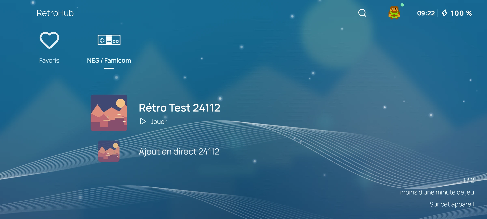

<a id="readme-top"></a>

<div align="center">
  <a href="https://simon-verbois.github.io/retrohub-app/">
    
  </a>
  <h1>RetroHub for Android</h1>
  <p>Your RetroHub library, ready to play anywhere.</p>
  <p>
    <a href="https://github.com/simon-verbois/retrohub-app/releases"><strong>Download the APK</strong></a>
    · <a href="https://simon-verbois.github.io/retrohub-app/">Website</a>
    · <a href="https://github.com/simon-verbois/retrohub-app/issues">Report an issue</a>
  </p>
</div>

<p align="center">
  <a href="LICENSE"></a>
  
  
</p>

<details>
  <summary>Table of contents</summary>

- [About the project](#about-the-project)
- [Getting started](#getting-started)
- [Usage](#usage)
- [Development](#development)
- [Roadmap](#roadmap)
- [Contributing](#contributing)
- [License](#license)
- [Support the project](#support-the-project)
- [Contact](#contact)
- [Acknowledgments](#acknowledgments)

</details>

## About the project

[](https://simon-verbois.github.io/retrohub-app/)

RetroHub brings your self-hosted game library to an Android phone or handheld. Download games
from your [RetroHub server](https://github.com/simon-verbois/retrohub), play with built-in
emulators, and continue your progress on the web or another device.

- Play downloaded games offline; synchronize when the connection returns.
- Navigate with a controller, touch or keyboard, in landscape or portrait.
- Browse your library and the server catalogue, search games and manage favorites.
- Synchronize saves and save states, with a choice when progress conflicts.
- Adjust touch controls, display and emulator options per game or console.

The interface is currently in French. Android is available; the Kotlin Multiplatform codebase
also prepares for iOS, which is not released yet.

### Built with

[Kotlin Multiplatform](https://kotlinlang.org/multiplatform/),
[Compose Multiplatform](https://www.jetbrains.com/compose-multiplatform/),
[Ktor](https://ktor.io/), Room, WorkManager and
[LibretroDroid](https://github.com/Swordfish90/LibretroDroid).
See the [core inventory](docs/cores.md) for emulator versions and platform constraints.

## Getting started

### Prerequisites

An Android device and a reachable [RetroHub server](https://github.com/simon-verbois/retrohub).
The server provides your library, games and saves.

### Installation

1. Download the signed APK from [Releases](https://github.com/simon-verbois/retrohub-app/releases).
   Each release includes SHA-256 checksums.
2. Install the APK on your device, allowing installation from that source when Android asks.
3. Enter your server address.
4. Pair with the code shown on the web under **Settings → Apps and devices**, or sign in with
   your password. QR-code pairing is also available.
5. Choose your starting settings and download a game from your library.

## Usage

Open a game and choose Play or Resume. Download it before going offline. Save and close the
game before switching devices so the next device receives your latest progress.

Use the pause menu to change controls, image and sound settings. Conflicting progress asks
for your choice before anything is replaced. Save states require compatible ROM and core
versions; see the [core notes](docs/cores.md).

## Development

### Requirements

Linux x86_64 with KVM (`/dev/kvm`), Git, `curl`, `unzip`, `uv`, and the server repository
checked out alongside this one as `../retrohub` for end-to-end tests.
Android Studio and a separate Gradle installation are not required.

```sh
git clone https://github.com/simon-verbois/retrohub-app.git
cd retrohub-app
scripts/setup-sdk.sh        # JDK 21 and Android SDK in ~/Android
scripts/fetch-cores.sh      # Verified emulator cores
./gradlew :app:assembleDebug
scripts/start-retrohub.sh --backend
```

The last command launches the app in a landscape emulator and starts a disposable server at
`http://127.0.0.1:8011` (test account: `e2e-admin` / `test-browser-password-only`). Use
`--fresh` to start from first launch. Without `--backend`, use your own server.

For a real phone:

```sh
adb install -r app/build/outputs/apk/debug/app-debug.apk
```

Build for a single device architecture with `./gradlew :app:assembleDebug -Pretrohub.abis=arm64-v8a`.

### Verification

```sh
./gradlew spotlessCheck :app:lintDebug
scripts/test.sh unit        # Also: instrumented, e2e, all
RETROHUB_AVD=retrohub-ci RETROHUB_EMULATOR_PORT=5582 scripts/ci.sh
```

The full pipeline clears test app data; use the separate virtual device shown above.
Inspect the end-to-end screenshots in `build/screens/`.

### Documentation and website

- [Design decisions](docs/decisions.md), [emulator cores](docs/cores.md) and [iOS status](docs/ios.md).
- [Localization](docs/localization.md) and [server integration requests](docs/server-requests.md).

The static GitHub Pages site lives in `docs/`, in English, French, German, Spanish, Italian,
Dutch and Portuguese. Edit `docs/site-template.html`, `docs/styles.css`, `docs/site.js` and
`docs/locales/`, then regenerate the pages:

```sh
python3 scripts/build_site.py --generate
python3 scripts/build_site.py --check
python3 scripts/build_site.py --output build/site  # Empty output directory required
```

Project screenshots live in `docs/screenshots/`; fonts and images are served locally.
The Pages workflow publishes only the generated pages and their assets.

## Roadmap

Follow [open issues](https://github.com/simon-verbois/retrohub-app/issues) and the
[changelog](CHANGELOG.md). iOS preparation and additional interface languages are documented
in the [iOS](docs/ios.md) and [localization](docs/localization.md) notes.

## Contributing

Open an issue with your Android version, device, console and steps to reproduce, or propose
a focused pull request. Run the checks above and add an English note under **Unreleased**
in [CHANGELOG.md](CHANGELOG.md) for a visible change. Keep interface text in French.

## License

The app code is under the [MIT license](LICENSE). The APK bundles LibretroDroid (GPL-3.0)
and libretro cores under their respective licenses; see [third-party licenses](docs/licenses.md).

## Support the project

If RetroHub is useful to you, you can [buy me a coffee](https://buymeacoffee.com/simonverbois).
Reporting issues, sharing the project and contributing also help.

<a href="https://buymeacoffee.com/simonverbois"></a>

## Contact

[Simon Verbois](https://github.com/simon-verbois) ·
[Project issues](https://github.com/simon-verbois/retrohub-app/issues) ·
[RetroHub server](https://github.com/simon-verbois/retrohub)

## Acknowledgments

- The LibretroDroid and libretro projects, and each emulator core's authors.
- [Best-README-Template](https://github.com/othneildrew/Best-README-Template) for the README structure.

<p align="right"><a href="#readme-top">Back to top</a></p>

---

Personal project, developed with the help of AI. It is experimental and may contain
errors: please review the code and report any issues you find.
